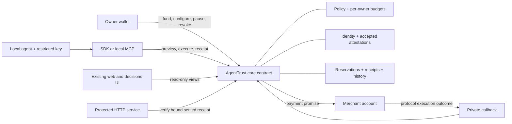
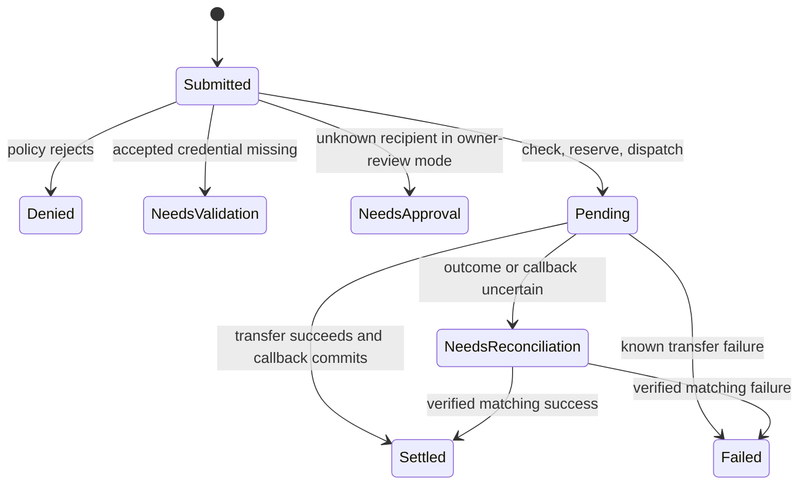

# AgentTrust NEAR: recommended architecture and build sequence

Research recommendation, 10 November 2026. No port has been implemented or deployed. Supporting evidence: [NEAR core](01-near-core.md), [AgentTrust source](02-agenttrust-source.md), [ecosystem/event](03-near-ecosystem-event.md), [UI/docs](04-ui-and-docs-port.md).

Product scope updated 11 November: [09 — Feature specification](09-feature-spec.md) is authoritative for gate/list behavior, profile requirements, approvals and counter semantics. [10 — Competitive strategy](10-competitive-strategy.md) defines the proposed demonstration. The initial blanket recommendation to preserve all five old gate concepts was revised after tracing the actual lists and examining current competition.

## Product and money flow

Keep AgentTrust's existing interface and purpose: **an AI agent can buy a service only within the owner's spending and counterparty rules. Enforce those rules natively on NEAR.**

Proposed demo: an owner funds a vault with 1 testnet NEAR and permits an agent to spend at most 0.01 NEAR per request and 0.05 per UTC day. The agent receives a key that can call only the vault's payment method. It buys a 0.005 NEAR API response from a registered, appropriately attested service. An oversized payment is rejected before dispatch. The owner can pause/revoke new spending. These are demo parameters, not observed usage or demand evidence.

The owner deposits funds into contract custody. This differs from composing a payment out of their ordinary wallet on Solana. A shared testnet vault is a practical hackathon design with explicit operator upgrade authority, not a production trustless-custody claim.

## Architecture decision after studying NEAR

| Option | Benefit | Limitation | Recommendation |
|---|---|---|---|
| SDK preflight + wallet transfer | Smaller port; standard x402 NEAR transport exists | Full-access/payment-key holder bypasses advisory policy | Reject as core enforcement model |
| Three separately deployed contracts | Similar to old program diagram | More asynchronous reads, stale-state and callback edges | Keep three logical modules in one contract initially |
| One core contract + funded native NEAR vault | Restricted worker authority; self-contained testnet | External transfer is still asynchronous; custody changes | **First milestone** |
| Vault + one NEP-141 token | Closer to original stablecoin use case | Token trust, storage, deposits, callbacks and test asset needed | Second gated milestone |
| Internal vault ledger transfer | Policy, ledger balances and history commit in one receipt | Recipient gets a vault claim; withdrawal remains asynchronous | Alternative only if merchant accepts this custody model |
| Intents/MPC/TEE-first | More cross-chain/runtime functionality | More trust and recovery dependencies; not event-mandated | Defer |

This preserves the safety goal without claiming Solana's mechanism. [NEAR cross-contract calls](https://docs.near.org/smart-contracts/anatomy/crosscontract), [upstream exact-NEAR scheme](https://github.com/x402-foundation/x402/blob/1d2858cf5d3a7df6938737eb61ebaacf59b1733f/specs/schemes/exact/scheme_exact_near.md).



The merchant-to-callback arrow means the protocol's promise result; the merchant cannot invoke the private callback to assert success.

Components: Rust `agenttrust-core` with policy/registry/treasury/receipt modules; TypeScript NEAR SDK; custom HTTP 402 adapter and paid-service example; signer-owned local MCP plus read-only hosted MCP; existing web/docs/status/decisions surfaces. Separate source modules do not require separate deployed accounts. Remove Anchor/SPL/PDA/Quantu code from the authoritative NEAR path.

## Authority and custody

1. Owner wallet funds a per-owner vault balance and configures policy.
2. Owner installs a function-call key on their account, restricted to the exact core contract and only `execute_payment`, with a finite nonzero gas allowance.
3. Owner registers the public key against that owner, agent, policy and expiry in contract state. Never trust caller-supplied owner/agent labels as authority.
4. Worker calls with zero attached deposit. The vault verifies a direct call (`predecessor == signer`), the registered signing key/session, and policy. Funds come from the prefunded vault.
5. Management/withdrawal methods authenticate owner authority; positive security deposits are useful where appropriate. The worker cannot change policy, withdraw arbitrarily, alter attestors, manage keys, or upgrade.
6. Revocation has two controls: revoke the contract session and remove the NEAR access key. Pause/revocation stops new dispatch; it cannot recall an already-dispatched payment.

Function-key allowance covers **gas**, not merchant spend; the contract enforces monetary limits. Give the worker no full-access owner key, vault deploy key, independent Intents key, or generic MPC signing endpoint. [Access keys](https://docs.near.org/protocol/accounts-contracts/access-keys).

NEP-366 relaying changes signer/predecessor context. Reject it in this direct-key milestone. Later sponsorship needs a separately specified signed application/session authorization; do not authorize from the relayer's key. [Meta-transactions](https://docs.near.org/protocol/transactions/meta-tx).

A shared vault operator retaining full-access/deployment authority can upgrade code or move native funds. Disclose operator control, contract account/code hash and demo-only funding. Per-user vaults help isolation only if upgrade/key ownership is also user-controlled or immutable. Avoid irreversible key removal as a rushed shortcut.

Per-owner accounting must pay that owner's bounded storage liabilities and allocate operational costs explicitly. One tenant cannot consume another's deposits through record creation or gas/storage subsidy. Keep deposit funds, refundable claims, pending transfers, protocol storage stake and operating reserves distinct.

## Minimum state and API

Design sketches, not final ABIs:

| Record | Essential fields |
|---|---|
| Vault | owner, available claim, reservations, storage credit, liquid/operating safeguards |
| Agent | owner, agent ID, key(s), authorized payout/service account, metadata commitment, active flag |
| Session | owner, agent, key, policy, expiry, revoked flag |
| Policy | Owner/revision, asset, emergency pause, owner-wide day cap and fixed dispatch-count window, per-session purchase cap/profiles, explicit trust/block and capability issuer rules |
| Credential | subject agent/account, issuer, namespace/version, evidence commitment, issue/expiry times, revocation/revision |
| Payment | immutable payload hash, owner/agent/policy version, actual payout account, asset/raw amount, invoice/request commitment, nonce/expiry, charged window IDs, state, outcome evidence |
| History | settled count/volume; separately labeled issuer assertions, not automatic quality scores |

Proposed owner methods: `deposit`, `set_policy`, `register_session`, `revoke_session`, `pause`, `withdraw_available`. Worker: `execute_payment`. Views: `preview_payment`, `get_payment`, `list_recent_decisions`, `get_policy`. Private: `on_payment_result`. Registry: account-owned registration and issuer-authenticated credential issue/revoke/renew. Withdrawal needs the same reservation and callback discipline as merchant payouts.

SDK: `previewPayment`, `executePayment`, `getPayment`, `awaitPayment`, `payService`. Amounts are U128 decimal strings with explicit asset IDs. Preserve high-level workflows without pretending Solana keys/IDL/transaction-return types remain compatible. A timeout from `awaitPayment` reports uncertainty, not permission to pay again.

## Settlement and accounting

Keep decisions (`Allow`, `Deny`, `RequireValidation`, plus `RequireApproval` only when its complete flow exists) separate from payment states (`Pending`, `Settled`, `Failed`, `NeedsReconciliation`).



Authoritative execution must:

1. Check session, network/contract domain, policy version, nonzero exact asset/amount, actual payout binding, request commitment, expiry and payment ID.
2. Resolve subject-bound trust/capability locally. A reputable agent ID cannot authorize payment to an unrelated account supplied by a caller.
3. Enforce limits against **settled spend plus outstanding reservations**. Make emergency pause unconditional for worker spend.
4. Reserve balance and capacity and persist the payment before dispatch. Concurrent requests see those reservations.
5. Use a private callback with enough reserved gas and minimal bounded state writes. Check expected payment state; repeated callbacks are idempotent.
6. Commit settlement/history once on actual success; release reservations only on authoritative failure. A settled payment does not prove good service.

An idempotency key binds one immutable payload hash. Exact repeats return prior state; changed amount/recipient/resource under that key is rejected. An API restart cannot reset replay protection because the authoritative record is on chain.

Track dispatch-time day/window identities and policy revision with each reservation. Callbacks after rollover or policy edits must never subtract an old reservation from new counters. Admission counts today's settled dispatches plus all unsettled reservations, including earlier days, as specified in [09](09-feature-spec.md#exact-approvals-retries-and-counters). Policy updates do not erase pending liabilities. Weekly budgets are deferred.

One receipt's writes can revert together, but later receipts cannot roll earlier transfers back. **Transfer success followed by callback failure can leave funds paid and bookkeeping unresolved. Keep the reservation held; never refund or dispatch a second payout based on timeout.** Ordinary contracts cannot query arbitrary historical RPC outcomes themselves. Recovery requires independently verifiable matching execution evidence or an explicitly trusted reconciliation authority. Until that exists, unresolved funds may stay locked. Disclose this bounded liveness limitation; do not ship a generic admin “retry payment” button.

Native transfer failure can generate a separate refund receipt. Restoring an accounting claim does not prove liquid funds have returned. Use a conservative aggregate backing rule for the first native implementation:

```text
A = sum of all owners' available claims (excludes dispatched reservations)
B = env::account_balance() at the actual execution point
S_post = required storage stake after the planned bounded writes
O = nonspendable operating reserve plus any other liquid liabilities not already in A

Before payout x: owner.available >= x AND B >= S_post + O + A
Then: owner.available -= x; A -= x; persist reservation; schedule payout x
```

Pinned nearcore source establishes that `account_balance` reads `current_account_balance`, and promise attached balances deduct that value. Once the outgoing promise is actually constructed, the runtime debits `B` by `x`; it is incorrect to subtract every pending payment again from that already-debited balance. If a definitive-failure callback restores `A` before the native refund arrives, the aggregate backing check blocks new payouts/withdrawals until real `B` recovers. Do not add a refund receivable to `B`. Track any newly scheduled-but-not-yet-reflected amounts explicitly if sampling balance earlier; Rust Promise construction can be lazy, so source-level order must match actual host calls. This is a conservative design inference, not an executed accounting proof. Verify deposit/storage charges, withdrawals, multiple calls, callback/refund ordering and lazy construction in receipt-level tests. [Pinned VM balance/deduction implementation](https://github.com/near/nearcore/blob/bc4e9e8cfb03d9e82f027883055624e18576993e/runtime/near-vm-runner/src/logic/logic.rs), [balance host getter](https://github.com/near/nearcore/blob/bc4e9e8cfb03d9e82f027883055624e18576993e/runtime/near-vm-runner/src/logic/host.rs).

Policy denials intended to persist in the decisions feed should return a typed decision normally. Authentication errors may reject outright; do not infer durable denial events from a failed/panicking receipt.

## Revised gate scope

| Concept | Native specification |
|---|---|
| KillSwitch | Owner emergency pause; pending payments still resolve |
| Spending | Native NEAR; per-session purchase and owner-wide UTC-day caps including reservations; weekly deferred |
| Velocity | Owner-wide dispatched-attempt count per fixed 60-second window; failed transfers still count; no tier multiplier |
| CounterpartyTier | Remove numeric tier/risk/confidence authorization; replace with owner-approved exact service identities, block overrides and explicit unknown handling |
| RequireValidation | Exact capability/subject/version, accepted issuer, expiry/revoke/renew; typed needs-validation result |

The initial proposal included issuer-assigned tiers. The revised product removes those tiers because no credible replacement dataset or scoring method has been established. Use explicit owner permission and narrowly scoped capability evidence, preserving issuer/evidence/expiry. Separate payment count/volume from quality/risk/confidence. Testnet self-payments are not Sybil-resistant reputation. Native NEAR caps must be labeled in NEAR; fiat display is informational unless a price-oracle policy is deliberately added. [Canonical decisions and precedence](09-feature-spec.md).

## The x402 compatibility boundary

Upstream NEAR x402 v2 exists, with `near:mainnet` and `near:testnet`, and published `@x402/near` 2.30.0 was observed. Standard `exact` permits one FullAccess-signed delegated `ft_transfer` with one yoctoNEAR. A vault `execute_payment` action is a different mechanism.

Label the first rail **custom AgentTrust native-NEAR HTTP 402 adapter**. Preserve the challenge/payment/resource experience and adapter boundary; do not claim generic `exact` conformance or drop-in Pay.sh compatibility. The experimental part is our vault binding, not NEAR's upstream x402 rail. [Exact-NEAR specification](https://github.com/x402-foundation/x402/blob/1d2858cf5d3a7df6938737eb61ebaacf59b1733f/specs/schemes/exact/scheme_exact_near.md).

Paid-service loop:

1. Protected endpoint issues a short-lived Ed25519-signed invoice binding schema/domain version, merchant identity and payout account, network, vault contract, payer owner/agent, policy version, amount/asset, request/resource hash, nonce and expiry. Use a versioned fixed Borsh schema with a domain prefix and shared Rust/TypeScript byte-vector tests, not ambiguous JSON serialization.
2. SDK authenticates the merchant key through configured/registered identity, rather than accepting a caller-supplied key as its own trust root. Preview is explanatory.
3. Worker invokes the vault with that exact tuple. **The recommended contract verifies the invoice signature on chain**, using the Ed25519 key registered by the authenticated merchant account and checking its payout binding/status. The SDK performs the same check for early feedback. The contract must not accept a caller-supplied public key as its trust root. Tagged `near-sdk` 5.30.1 exposes `env::ed25519_verify`; this establishes primitive availability, not a tested invoice protocol. [SDK implementation](https://github.com/near/near-sdk-rs/blob/near-sdk-v5.30.1/near-sdk/src/environment/env.rs).
4. SDK waits for a final authoritative outcome and presents the payment ID.
5. Service independently verifies contract/receipt state and exact merchant/resource/asset/amount binding. An HTTP 200, accepted transaction, or arbitrary client-provided hash is insufficient. Release content only after settlement.
6. Receipt reuse may return the identical paid response but cannot purchase another resource/job. A single on-chain payout is not sufficient protection against server-side resource replay without request binding.

This is pre-payment policy enforcement, not escrow, reversal, insurance or proof of service quality. A later upstream `exact` direct-wallet adapter can be offered with clearly advisory policy semantics; a contract-gated MPC signer is a more involved possible bridge. Neither is required for this first native vault demo.

## FT milestone after native correctness

Add one allowlisted NEP-141 asset with verified account/code, decimals and storage behavior. A custom test token must not be labeled real USDC. Deposits via `ft_transfer_call` authenticate `ft_on_transfer` predecessor as the token contract and credit the actual sender under a bounded validated message. Native and FT accounting/caps remain separate.

Register vault/merchant storage as required by NEP-145. Vault outbound `ft_transfer` attaches one yoctoNEAR from operating funds; worker execution still attaches zero. Token code/admin trust is explicit: a malicious token can return success without transferring economic value. Prefer plain `ft_transfer` for ordinary payout; if receiver execution requires `ft_transfer_call`, implement unused-amount/resolver semantics and only count the actually accepted amount. Registration, gas, deposits and callbacks are separate costs. Do not add multi-asset dollar conversion during the first build. [NEP-141](https://github.com/near/NEPs/blob/master/neps/nep-0141.md), [NEP-145](https://github.com/near/NEPs/blob/master/neps/nep-0145.md).

## Keep, add, replace, defer

| Keep | Add | Replace in active path | Defer |
|---|---|---|---|
| UI/docs design, typed decisions, adapter boundary | Sessions, prefunded treasury, explicit service trust/block and issuer policies, reservations, callbacks, durable idempotency, receipt verification | Anchor/SPL/PDA/Quantu, numeric tier gates and slot-based arithmetic | Weekly caps, Intents/1Click, cross-chain MPC |
| Signer-owned local MCP / read-only hosted concept | Local `pay_service` or complete SDK agent example | Shared hosted signer or full-access worker credential | TEE runtime attestation |
| Original tests as specifications | Authority, concurrency, replay, failure and callback tests | Old proof counts, atomicity claims, unsupported live adapter badges | ATOM-like scoring engine, disputes platform, new dashboard redesign |

One contract can keep three visual module cards; it must not claim three deployed contracts. Keep the current layout while making chain guarantees and evidence truthful.

## Required verification before claiming success

These are proposed tests, not completed results:

| Scenario | Expected evidence |
|---|---|
| Worker direct-transfer/admin bypass | Protocol/contract rejects; no value leaves |
| Allowed API purchase | One dispatch, matching successful outcome, settled receipt, actual resource response |
| Over-purchase/day/dispatch-count cap | Typed denial, no dispatch or consumed spend capacity |
| Concurrent requests straddle cap | Total reservations stay within policy |
| Duplicate/restart/changed tuple | Exact prior outcome or deterministic conflict; never second payout |
| Paused/revoked/expired key | No new dispatch; pending liability retained |
| Wrong/stale/revoked/unaccepted credential | Explicit policy result; no subject substitution |
| Transfer failure / callback failure after success | Correct reservations, liquidity and unresolved states; no timeout refund/resend |
| Fake/repeated callback | Rejected or idempotent, no duplicated history/counters |
| Rollover/policy edit with pending payout | Original reservations and window semantics retained |
| Forged invoice/key/domain / forged hash / wrong resource receipt | Contract rejects invalid invoice; service refuses mismatched receipt/content request |
| Withdrawal with pending funds | Only genuinely available funds can leave |
| Owner storage exhaustion / malicious tenant | Bounded owner-paid records; no other tenant's balance consumed |
| FT extension | Storage/unused amounts/token identity/callback outcomes verified |
| UI/docs | Same design, actual NEAR links/amounts, pending distinct from settled, accurate claims and assistant corpus |

Use unit/property checks for arithmetic/state transitions and near-workspaces/sandbox integration for actual authority/receipt ordering/failure/concurrency. These are proposed checks: Sandbox persists chain database state and execution remains subject to the standing database-write restriction. No such runtime was run here. Pure-function proofs do not establish host-runtime safety. Record exact binary hash, versions, commands and outcomes; final testnet evidence includes accounts, payment ID, transaction plus relevant receipts, amount/asset, expected result and reproducible steps, without private keys.

## Build order and stop conditions

1. Freeze upstream baseline and native specification → verify custody, asset, direct-only authority, windows and outcomes each map to checks.
2. Implement policy/vault/key boundary → verify allowed payment, denial, pause/revoke, replay, concurrent reservations and native failure/callback paths.
3. Complete paid API loop and local agent tool/example → verify challenge binding, independent final receipt check and real returned resource.
4. Port existing UI/docs data and evidence → verify visual preservation, actual live states/links, accurate commands, search/Ask AI corpus.
5. Attempt one FT adapter only after native checks pass → otherwise finish native evidence; keep Intents/MPC/TEE off the critical path.
6. Reproduce and package → README with expected results per step, public baseline-to-NEAR diff/disclosure, demo and availability through judging. Re-read rules before the user publishes/submits.

Deadline: **15 November 2026, 05:29 IST** (14 November 23:59 UTC). Suggested personal buffers: stop new features by 14 November noon IST; prepare the full submission package by 14 November 21:00 IST. These are proposals, not organizer requirements or scheduled alarms. [Official rules](https://nearhackathon.com/HACKATHON.md).

No measured engineering estimate is available. This remains substantial contract/security work even with an unchanged frontend. Do not expand features to compensate for an unreliable core demonstration.

## Revisit conditions and unresolved evidence

A verified native registry could replace the local subset. A supported upstream vault-payment x402 mechanism could remove the custom qualification after conformance tests. A hard stablecoin requirement would move FT into core and require cutting optional breadth. Production intent would reopen vault isolation, governance, recovery proofs, storage economics, operational liveness and external review.

No NEAR contract/payment, restricted-key workflow, callback test, UI interaction, package compatibility suite, x402 conformance run or benchmark was executed in this research. Next meaningful work is implementing and verifying the native settlement/key boundary, using this document as a reviewable specification.
